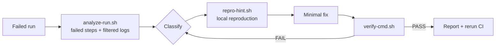

# fix-ci

**Your agent, on-call for CI.**

Point your agent at a failed GitHub Actions run → get the root cause, a local reproduction, a minimal verified fix, and the evidence. No guess-edits. No disabled checks.

```text
$ "CI 挂了，帮我看看"
→ fetched run #8472 on feature/checkout — FAILED at step "Run tests"
→ classified: test — AssertionError: expected 80, received -1900 (src/pricing.js:12)
→ reproduced locally: node test.js
→ root cause: applyDiscount() treats percent as a fraction — one-line fix
→ verify: node test.js → VERDICT: PASS
→ report: root cause, diff, evidence, rerun instructions
```

## Why this skill exists

Agents are good at reading errors and bad at CI discipline: they ask you to paste 4,000-line logs, guess at causes, and sometimes "fix" red by skipping the failing test. `fix-ci` encodes the loop a good engineer follows — and refuses the escapes that make green meaningless.

| Agent without fix-ci | With fix-ci |
|---|---|
| asks you to paste the logs | fetches and filters them itself |
| guesses at causes | walks a failure-class playbook |
| "fixes" red by deleting tests | stopped by hard anti-cheat rules |
| says "should work now" | must show `VERDICT: PASS` |
| silently breaks things | delivers a triage report when stuck |

## Install

Requirements: [`gh` CLI](https://cli.github.com) authenticated (`gh auth login`), and an Agent Skills–compatible host (Claude Code, Qoder, or similar).

```bash
git clone https://github.com/Ruyue213/fix-ci.git

# Claude Code
cp -R fix-ci ~/.claude/skills/fix-ci

# Qoder (user-level or project-level)
cp -R fix-ci ~/.qoder-cn/skills/fix-ci
cp -R fix-ci .qoder/skills/fix-ci
```

Restart the session (or run `/skills reload`), then just talk:

- “CI 挂了，帮我看看”
- “why is my build failing on this branch?”
- “fix the failing tests on CI”

## Try it in 3 minutes

No need to break your own repo — [`demo/fixtures`](demo/fixtures) ships five reproducing failures:

```bash
gh repo create fix-ci-demo --private --clone && cd fix-ci-demo
cp -R <path-to>/fix-ci/demo/fixtures/02-failing-test/. .
git add -A && git commit -m "broken fixture" && git push -u origin HEAD
```

Watch CI go red, then point fix-ci at it. Each fixture has a `FIXTURE.md` describing the expected root cause and fix — compare what your agent finds.

| Fixture | Class | Red because |
|---|---|---|
| `01-missing-dependency` | dependency | `Cannot find module 'left-pad'` |
| `02-failing-test` | test | `AssertionError: -1900 !== 80` |
| `03-flaky-test` | flaky | intermittent failure (~50% per run) |
| `04-oom-kill` | oom | `JavaScript heap out of memory` (exit 134) |
| `05-missing-secret` | permissions | `401 Unauthorized — DEPLOY_TOKEN is not set` |

## What it handles

| Class | Examples |
|---|---|
| build | type errors, syntax errors, lint failures |
| dependency | missing packages, lockfile drift, peer conflicts |
| test | assertion failures, deterministic test bugs |
| flaky | races, timing assumptions, order dependence |
| oom | leaks, unbounded memory, hangs, step timeouts |
| permissions | missing secrets, 401/403, read-only tokens |
| config | invalid workflow YAML, bad expressions, action inputs |
| infra | runner/network outages (reports, never guess-fixes) |

## The anti-cheat guarantee

A CI fix must change the reason CI is red — never the reporting of it.

| Forbidden | Instead |
|---|---|
| `.skip` / deleting failing tests | fix the failure, or quarantine with a tracking issue and your approval |
| `continue-on-error: true` to mask failure | fix the root cause; remove obsolete checks only as an approved, separate change |
| retries / bigger timeouts as "the fix" | fix the race or the hang |
| editing assertions to match buggy output | fix code or test based on intended behavior |

Full rules: [`references/anti-cheat.md`](references/anti-cheat.md).

## How it works



## Scripts

| Script | What it does |
|---|---|
| `scripts/analyze-run.sh` | fetches the failed run via `gh`: failed jobs/steps, keyword-filtered error excerpt, raw log path — no giant log dumps into context |
| `scripts/repro-hint.sh` | extracts the failing step's command from workflow YAML for local reproduction |
| `scripts/verify-cmd.sh` | runs the exact CI command locally and prints `VERDICT: PASS/FAIL` with output evidence |

## Evals

Fix quality is measured, not claimed. [`evals/fixtures.md`](evals/fixtures.md) defines a 20-case benchmark across all eight failure classes. The five `demo/` cases are runnable today; an automated harness and per-release pass rates land in v0.2. Numbers will be published in the README when they exist — not before.

## Limitations

- v0.1 supports **GitHub Actions** only; the playbooks apply to other providers, but log fetching is GitHub-specific.
- Needs `gh` + network access.
- Repo-settings fixes (secrets, permissions) cannot be applied by the agent — it will tell you exactly what to change and where.
- Logs are truncated by design to keep context bounded; the raw log path is always printed for drilling in.

## Roadmap

- v0.2 — eval harness in CI, published scores, GitLab CI log adapter
- v0.3 — CircleCI adapter, incident-style run reports
- Later — opt-in auto-PR mode (always behind explicit confirmation)

## Contributing

- Open an issue with a **sanitized** failing-log excerpt (strip tokens/secrets first) to propose a new failure class or fixture.
- PRs adding fixtures are especially welcome — every new failure class makes the benchmark stronger.
- The anti-cheat rules are non-negotiable; PRs that weaken them will be declined.

## License

[MIT](LICENSE)
